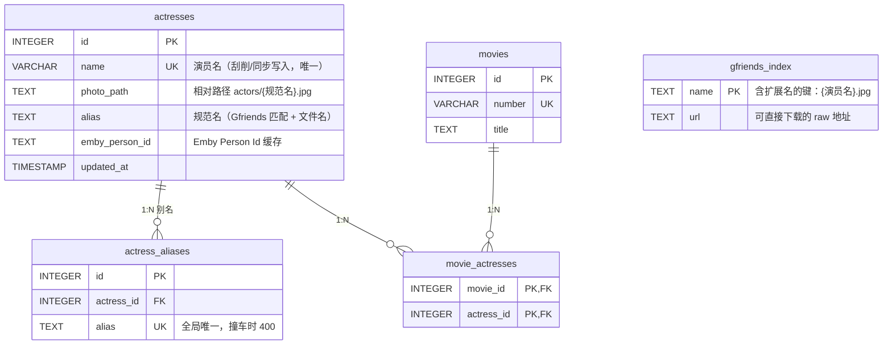

# 演员管理（演员库 + 头像刮削）设计

日期：2026-11-23
状态：已评审通过

## 背景与目标

新增演员管理功能：从本地已刮削媒体和 Emby 上（能识别到番号的媒体）读取女演员，
刮削对应照片。调研结论：

- JavSP 只有"半成品"：`javbus`/`jav321` 站点解析器抓女优头像 URL（`MovieInfo.actress_pics`），
  仅写入 NFO `<actor><thumb>`；无下载、无演员库、无 Emby 联动。
- MDCx（`sqzw-x/mdcx`，`tools/emby_actor_image.py` / `emby_actor_info.py`）实现了完整功能：
  `/emby/Persons` 拉演员列表 → Gfriends 头像库（Filetree.json 缓存 + `{名}.jpg` 精确匹配）/
  graphis.ne.jp / 本地头像夹三级来源 → 下载裁 2:3 → Base64 上传到 `Items/{personId}/Images/Primary`；
  另有 Kodi `.actors` 模式、Wikipedia+本地库的演员资料补全、刮削后自动补全（ACTOR_PHOTO_AUTO）。
- Gfriends（`gfriends/gfriends`）：社区女优头像仓库，`Content/{上传者}/{名}.jpg`，
  `Filetree.json` 为索引，按 `{日文名}.jpg` 精确匹配 → **别名（中文名→日文名）映射是命中率关键**。

## 已确认的决策

- 头像数据源：**Gfriends 头像库为主**（不做站点实时抓取兜底，留待后续）。
- 存储：**本地 `data/actors/` + 可选推送 Emby**（Emby 推送目标为独立的 Person 条目，与影片无关）。
- 演员来源：本地用 `actresses` 表；Emby 侧只取 `emby_items` 中已识别番号条目的演员
  （不做 `/Persons` 全量拉取，避免混入非 AV 库演员）。
- 后端代码新包 `top.sincs.sinjav.actor`。
- 功能范围：演员列表页、演员详情（含别名编辑、所属影片）、刮削后自动补头像、别名映射编辑。

## 数据模型（V6__actress_photo.sql，sqlite + postgresql 双套）

- `actresses` 加列：`photo_path TEXT NULL`、`alias TEXT NULL`（规范名，用于匹配与文件名）、
  `emby_person_id TEXT NULL`、`updated_at TIMESTAMP`
- 新表 `actress_aliases(id, actress_id, alias UNIQUE)` —— 多别名，匹配时逐一尝试
- 新表 `gfriends_index(name UNIQUE, url)` —— Filetree.json 解析结果落库
- 本地照片：`data/actors/{规范名}.jpg`，路径相对化存 `photo_path`
- 实现方式：JDBC（data class + NamedParameterJdbcTemplate），对齐项目既有风格；SQLite 外键默认关闭，删演员需手工级联删别名

## 后端（新包 actor）

1. `GfriendsService`
   - `syncIndex()`：下载 Filetree.json（URL 可配置、支持代理），解析 upsert；
     记录同步时间，超阈值（7 天）自动重同步
   - `findPhoto(name)`：按 `aliases + name` 优先级查 `{名}.jpg` / `{名}.png`
   - 下载复用 `ImageStore`（下载 + `valid_pic` 校验）
2. `ActorPhotoService`
   - `scrapePhoto(actressId)`：查索引 → 下载 → 写 `photo_path` → 配置开启且有
     `emby_person_id` 则推送 Emby
   - `scrapeAllMissing()`：批量补全（列表页按钮），异步任务 + 进度上报
   - 刮削自动补全：`ScrapeService.execute()` 收尾（收集循环内 `markScraped` 返回的新建演员 id）
     与 `EmbyRescrapeService.apply()` 收尾（重刮落库的演员先并入本地演员库，新建的那部分才算新演员）
     各挂一份 `scrapePhotosAsync(actressIds, reason): Long?`——双入口共用同一实现：
     过滤已有 `photo_path` 的演员 → 建 `actor_photo_auto` 任务（params 含 reason）→ 派发到任务线程池后
     立刻返回 jobId，不阻塞刮削/重刮；开关 `sinjav.actors.auto-scrape-after-batch`（默认 true）关闭时两个入口都不触发
3. `EmbyActorSyncService`
   - 扩展 `EmbyClient.detailFrom` 解析条目 `People`（Role=Actor）
   - `syncFromEmby()`：遍历 `emby_items` 已识别番号条目 → 演员名归一化合并入本地表；
     顺带读 Person 的 `ImageTags.Primary` 标记 Emby 已有头像
   - `EmbyClient` 新增 `listPersons(searchTerm?)`；推送复用 Base64 POST 到
     `Items/{personId}/Images/Primary`

## API（ActorController，`/api/v1/actors`）

| 方法 | 路径 | 说明 |
|---|---|---|
| GET | `/actors` | 分页列表 `?page&size&search&hasPhoto` |
| GET | `/actors/{id}` | 详情 + 所属影片列表 |
| PATCH | `/actors/{id}` | 编辑 `{alias, aliases[]}` |
| POST | `/actors/sync-emby` | Emby 演员同步（异步任务） |
| POST | `/actors/scrape-photos` | 批量补全 `{actorIds?}` |
| POST | `/actors/{id}/scrape-photo` | 单个补全 |
| POST | `/actors/{id}/push-emby` | 推送 Emby（可 `{overwrite}`） |
| GET/POST | `/gfriends/status` / `/gfriends/sync` | 索引状态 / 手动同步 |

静态图片：`data/actors/` 挂静态资源，与封面同机制。

## 前端（sinjav_web）

- `ActorsView.vue`（路由 `/actors`，侧边栏"演员"）：头像网格（懒加载、无头像灰块）、
  搜索 + 有/无头像过滤；工具栏：补全头像 / 同步 Emby 演员 / Gfriends 索引更新；
  进度复用 ScrapeDialog 的任务进度模式
- `ActorDetailDialog.vue`：大图 + 别名 tag 编辑 + 所属影片卡片（跳 `/movies?number=`）+
  单演员"重新抓取头像 / 推送 Emby"
- 别名编辑合并进详情，不单独做页面

## 错误处理与边界

- Filetree 下载失败：保留旧索引；首次失败则任务中止并报错
- 索引无该演员：标记失败原因，占位显示；不做实时抓取兜底
- 图片校验失败：删文件、不写路径、计失败
- 同一演员多写法：同步/补全前 `normalize` 合并（`movie_actresses` 关联迁移，空行清理）
- 改规范名：照片文件改名、`emby_person_id` 失效重查
- 别名唯一性冲突：409 + 前端提示
- Emby 未配置/失败：返回明确错误码，本地功能不受影响
- 同名 Person 歧义：取名字完全相等者；仍多个则跳过记日志
- Emby 已有头像默认跳过（可 overwrite 强制）
- 本地有照片但 Emby 无该 Person：提示不报错
- 批量任务可取消、可复用进行中任务；单演员限速 1.5s（对齐 MDCx `scrap_interval`）

## 后续可选（第一版不做）

- 站点头像实时抓取兜底（对齐 JavSP `actress_pics`，javbus/javdb avatar 解析）
- graphis.ne.jp 头像/背景图
- 演员资料补全（Wikipedia / minnano-av）

---

# 交付情况（批次 8 收尾）

> 状态：**全部批次（1-8）已实现**，`./gradlew test` 全绿。
> 用户侧使用说明见 [`docs/guides/actor-management-guide.md`](../guides/actor-management-guide.md)；
> API 契约同步在 [`docs/openapi.yaml`](../openapi.yaml)（tag `actors`）。

## 1. 已实现功能清单

| 批次 | 功能 | 关键文件 | 测试覆盖 |
|---|---|---|---|
| 1 | 数据模型：`actresses` 扩列（photo_path/alias/emby_person_id/updated_at）+ `actress_aliases` + `gfriends_index`（SQLite/PostgreSQL 双套迁移）、实体与仓储 | `db/migration/{sqlite,postgresql}/V6__actress_photo.sql`、`actor/ActressEntity.kt`、`actor/ActressAliasEntity.kt`、`actor/GfriendsIndexEntity.kt`、`actor/ActressRepository.kt`、`actor/ActressAliasRepository.kt`、`actor/GfriendsIndexRepository.kt` | `ActorManagementIntegrationTest`（Flyway 真实迁移建表）、`EmbyActorSyncServiceTest` |
| 2 | Gfriends 头像库：Filetree.json 同步（阈值缓存、代理开关、同名多上传者取先出现者）、按名+别名匹配（`.jpg`/`.png`）、下载 + `valid_pic` 校验 | `actor/GfriendsService.kt`、`common/AppMetadataRepository.kt`（V7） | `GfriendsServiceTest`；`GfriendsLiveTest`（真实网络，`GFRIENDS_LIVE=true` 时启用） |
| 3 | 头像抓取：单个同步抓取（force 覆盖）、批量补全（进度上报/限速/协作式取消）、Emby Person 推送（尽力而为）、异步派发 | `actor/ActorPhotoService.kt`、`config/AppProperties.kt`（`actors` / `gfriends` 段） | `ActorPhotoServiceTest`（含 Emby 推送、自动补全入口） |
| 4 | Emby 集成：条目 `People` 解析、`/Persons` 列表、Person 主图上传（Base64）、按 `emby_items` 快照同步演员并回写 `emby_person_id` | `emby/EmbyClient.kt`、`actor/EmbyActorSyncService.kt`、`api/dto/EmbyDtos.kt` | `EmbyClientTest`、`EmbyActorSyncServiceTest` |
| 5 | 后端 API：列表/详情/别名编辑/单个抓取/批量任务/Emby 同步/Gfriends 状态与同步；新增任务类型 `actor_photo_batch`、`emby_actor_sync`；`/local-actors` 静态映射 | `actor/ActorController.kt`、`api/dto/ActorDtos.kt`、`job/{JobService,JobRunner,JobType}.kt`、`api/WebConfig.kt` | `ActorControllerTest`、`JobServiceActorTest`、`ActressRepositoryPagingTest`、`ActressServiceTest` |
| 6 | 双入口自动补全：批次刮削收尾（`ScrapeService`）+ Emby 重刮收尾（`EmbyRescrapeService`），共用 `scrapePhotosAsync` 异步派发 | `scraper/ScrapeService.kt`、`emby/EmbyRescrapeService.kt`、`domain/MovieRepository.kt`（`markScraped` 返回新演员 id） | `ScrapeServiceAutoPhotoTest`、`EmbyRescrapeAutoPhotoTest` |
| 7 | 前端：演员网格页（搜索/有头像三态过滤/补全头像/同步 Emby 演员/更新索引/任务进度弹窗）、演员详情弹窗（大图/别名 tag 编辑/所属影片/重抓头像） | `sinjav_web/src/views/ActorsView.vue`、`components/ActorDetailDialog.vue`、`api/index.ts`、`api/types.ts`、`router`、侧边栏 | `npm run build` + 人工验收 |
| 8 | 收尾：端到端集成测试、文档（设计文档/用户指南/openapi）、异常与日志统一、**Emby 演员同步后自动补全新演员头像** | `ActorManagementIntegrationTest.kt`、`docs/guides/actor-management-guide.md`、`common/GlobalExceptionHandler.kt`、`actor/EmbyActorSyncService.kt` | `ActorManagementIntegrationTest`（4 组场景 + 开关用例）、`EmbyActorSyncServiceTest`（触发/开关/无新演员） |

批次 8 的代码清理与统一：

- **异常处理统一**：`GlobalExceptionHandler` 补齐参数类型不匹配 / 缺少必填参数 / 请求体不可解析（400）、
  方法不支持（405）、路径不存在（404）的映射，兜底 500 记 ERROR（带堆栈）；演员端点不再各自 try-catch
  （`404`=演员不存在、`400`=参数/别名冲突、`409`=任务冲突）。
- **日志级别**：应用默认日志级别由 DEBUG 降为 INFO（`application.yaml`），业务 DEBUG 仅作为排障开关使用；
  无 `println`/临时调试输出残留。
- **资源关闭**：`Files.walk/list` 全部走 `use {}`，HTTP 响应由 JDK `HttpClient`/`BodyHandler` 管理，
  视频流由 `InputStreamResource`（Spring 负责关闭）与自定义 `Range` 流（`close()` 关 `RandomAccessFile`）成对释放。
- **无未完成标记**：源码中无 `TODO`/`FIXME`（仅 `xxx.jpg` 之类示例文案与 `XXX` NFO 分级字段）。

## 2. 配置说明

```yaml
sinjav:
  actors:
    photo-dir: ./data/actors          # 头像落盘目录；photo_path 存相对路径 actors/{规范名}.jpg
    scrape-interval-ms: 1500          # 逐个演员抓取间隔（对齐 MDCx scrap_interval），防风控；0 = 不限速
    push-to-emby: true                # 头像落盘后推送到 Emby Person 主图（需演员已缓存 emby_person_id）
    auto-scrape-after-batch: true     # 自动补全总开关：批次刮削 / Emby 重刮 / Emby 演员同步三处收尾
  gfriends:
    index-url: https://raw.githubusercontent.com/gfriends/gfriends/master/Filetree.json
                                      # 索引地址；其所在目录同时作为图片 raw 基址
    sync-threshold-days: 7            # 索引超过该天数才重新下载（<=0 = 每次调用都重下）
    enable-proxy: true                # 下载走全局代理（scraper.proxy-host/port，设置页可改）；GitHub raw 常需代理
```

| 配置项 | 默认值 | 生效位置 | 何时需要改 |
|---|---|---|---|
| `actors.photo-dir` | `./data/actors` | 落盘目录 + `/local-actors/**` 静态映射 | 想把头像放到 NAS/其他盘时 |
| `actors.scrape-interval-ms` | `1500` | 批量补全逐个演员的间隔 | 首次大批量补全想更快（风险：被 GitHub 限流） |
| `actors.push-to-emby` | `true` | `ActorPhotoService.pushToEmby` | 不想改动 Emby Person 主图时置 `false` |
| `actors.auto-scrape-after-batch` | `true` | 三个收尾入口（刮削 / Emby 重刮 / Emby 演员同步） | 想手动控制补全时机时置 `false` |
| `gfriends.index-url` | GitHub raw 地址 | `GfriendsService.syncIndex` | 使用自建镜像/离线索引时 |
| `gfriends.sync-threshold-days` | `7` | 索引是否过期判定 | 索引长期不更新（置 0 每次重下）或想减少流量（调大） |
| `gfriends.enable-proxy` | `true` | 索引与头像下载是否走代理 | 国内网络必须开；能直连 GitHub 可关 |

数据库与安全相关（既有配置，非演员专有）：`SINJAV_DB_URL` 切换 PostgreSQL；`/api/v1/**` 需登录会话。

## 3. API 端点文档

共 8 个端点（6 个演员 + 2 个 Gfriends 索引）。所有响应为 JSON；
错误统一为 RFC 9457 `application/problem+json`（`ProblemDetail`）。

> `/api/v1/gfriends/*` 同时注册为 `/api/v1/actors/gfriends/*`（设计文档写前者、批次任务书写后者，双写免返工）。

### 3.1 `GET /api/v1/actors` 演员分页列表

| 参数 | 位置 | 类型 | 默认 | 说明 |
|---|---|---|---|---|
| `page` | query | int | 1 | 页码（<1 归 1） |
| `size` | query | int | 20 | 每页条数（夹紧到 1..200） |
| `search` | query | string | — | 同时匹配 `name` / `alias` / `actress_aliases.alias`，空则不过滤 |
| `hasPhoto` | query | boolean | — | `true` 有头像 / `false` 无头像 / 缺省不过滤 |

```json
{
  "page": 1,
  "size": 20,
  "total": 1,
  "totalPages": 1,
  "items": [
    {
      "id": 7,
      "name": "夢乃あいか",
      "alias": "夢乃あいか",
      "photoPath": "actors/夢乃あいか.jpg",
      "movieCount": 12
    }
  ]
}
```

### 3.2 `GET /api/v1/actors/{id}` 演员详情

```json
{
  "id": 7,
  "name": "夢乃あいか",
  "alias": "夢乃あいか",
  "aliases": ["梦乃爱华", "Aika Yumeno"],
  "photoPath": "actors/夢乃あいか.jpg",
  "embyPersonId": "3f7c1b0e9a2d4c56",
  "movieCount": 2,
  "movies": [
    { "id": 11, "number": "ABP-123", "title": "ABP-123-示例标题", "coverPath": "/local-images/ABP-123/poster.jpg" }
  ],
  "updatedAt": "2026-11-23T09:31:07.512Z"
}
```

`404` — 演员不存在（`{"title":"Not found","detail":"演员不存在: 999","status":404}`）。

### 3.3 `PATCH /api/v1/actors/{id}` 编辑规范名与别名

```json
{ "alias": "夢乃あいか", "aliases": ["梦乃爱华", "Aika Yumeno"] }
```

- `alias`：`null`/省略 = 不修改；空串 = 清空（规范名回退 `name`）；
- `aliases`：**全量替换**，空数组即清空；
- 返回编辑后的详情（同 3.2）。

错误：`400` 别名已被其他演员占用（`actress_aliases.alias` 全局唯一）；`404` 演员不存在。

### 3.4 `POST /api/v1/actors/{id}/scrape-photo` 单个补全头像（同步）

| 参数 | 位置 | 类型 | 默认 | 说明 |
|---|---|---|---|---|
| `force` | query | boolean | `false` | `true` = 忽略本地已有文件强制重下（「重新抓取头像」按钮用；规范名改过后重抓才会让文件名跟随） |

无请求体。返回**枚举名字符串**（不是对象）：

| 返回值 | 含义 |
|---|---|
| `"SUCCESS"` | 命中并下载成功（已回写 `photo_path`，并按配置推送 Emby）；或 `photo_path` 为空而本地已有手工放置的 `{规范名}.jpg` 时直接登记该文件（不下载、不覆盖用户图片，与 `force` 无关） |
| `"SKIPPED"` | 已有照片且文件仍在，且 `force=false` |
| `"NOT_FOUND"` | Gfriends 索引里没有该演员（含别名逐一尝试） |
| `"DOWNLOAD_FAILED"` | 命中但下载失败 / `valid_pic` 校验不通过（已删除坏文件） |

```http
HTTP/1.1 200 OK
Content-Type: application/json

"SUCCESS"
```

### 3.5 `POST /api/v1/actors/scrape-photos` 批量补全（异步任务）

```json
{ "actorIds": [7, 8] }
```

- `actorIds` 空/省略 → 全部缺头像的演员；
- 返回 `202 Accepted` `{ "jobId": 42 }`；进度查 `GET /api/v1/jobs/{jobId}`，停止用 `POST /api/v1/jobs/{jobId}/stop`；
- 已有同类型（`actor_photo_batch`）任务在跑 → `409`。

### 3.6 `POST /api/v1/actors/sync-emby` Emby 演员同步（异步任务）

无请求体；遍历 `emby_items` 快照拉取条目 `People`，归一化后并入演员库并回写 `emby_person_id`；
本次新建的演员会再触发一个 `actor_photo_auto` 任务补头像（受 `auto-scrape-after-batch` 控制）。

```http
HTTP/1.1 202 Accepted

{ "jobId": 43 }
```

Emby 未配置时任务落 `failed`，`errorDetail` 说明「未配置 Emby 服务地址或 API Key」。

### 3.7 `GET /api/v1/gfriends/status` 索引状态

```json
{ "lastSyncAt": "2026-11-23T09:12:00Z", "indexCount": 34126 }
```

`lastSyncAt` 为 `null` 表示从未成功同步。

### 3.8 `POST /api/v1/gfriends/sync` 强制同步索引（同步执行，可能耗时数十秒）

```json
{
  "success": true,
  "message": null,
  "lastSyncAt": "2026-11-23T09:40:11Z",
  "indexCount": 34126
}
```

失败不抛 500：`success=false` + `message` 说明原因，**旧索引继续可用**（首次同步失败时索引为空）。

## 4. 数据库 ER 图



- `actresses` ↔ `actress_aliases`：**1:N**，`alias` 全局唯一（编辑接口先检查冲突再写，避免静默丢失）；
- `actresses` ↔ `movie_actresses` ↔ `movies`：**M:N**，`movie_actresses` 由 `MovieRepository.markScraped` 维护
  （重刮先清空该影片关联再插入，语义为全量覆盖）；
- `gfriends_index`：**独立表**（不与其他表关联），是 Filetree.json 的本地缓存，`name` 为主键（同名多上传者只留第一条）。

## 5. 已知限制

1. **SQLite 外键默认关闭**：`actress_aliases` 上的 `ON DELETE CASCADE` 不生效。当前没有「删除演员」端点，
   暂无孤儿风险；将来实现删除时必须先手工删 `actress_aliases`，或对连接执行 `PRAGMA foreign_keys=ON`
   （PostgreSQL 部署则天然生效）。
2. **同名演员歧义**：Emby 同步按「规范名」合并——同名但不同 Person 会合并成同一条演员记录，
   `emby_person_id` 以后同步到的为准（可能把头像推到另一个人的 Person 上）。出现同名不同人时，
   需手工改名/加别名区分（暂不做 Person 级精确匹配）。
3. **Gfriends 匹配规则为精确匹配且大小写敏感**：只尝试 `{名}.jpg` 与 `{名}.png`（`Rino.jpg` ≠ `RINO.jpg`），
   不做模糊/罗马字/假名归一。命中率取决于规范名与别名维护质量。
4. **`POST /actors/{id}/push-emby` 未实现**：设计稿列过该端点，实际只保留「下载后自动推送」
   （`actors.push-to-emby`）。前端详情弹窗的「推送到 Emby」按钮命中 404，提示「推送 Emby 功能开发中」。
5. **头像来源单一**：只有 Gfriends；站点实时抓取（javbus/javdb avatar）、graphis.ne.jp 均未实现。
6. **规范名变更不自动改名**：改 `alias` 不会重命名已有照片文件（`photo_path` 仍指向旧文件，仍可访问），
   需要新文件名时在详情弹窗点一次 **重新抓取头像**（`POST /actors/{id}/scrape-photo?force=true`，
   服务层会清理旧文件）。
7. **索引同步是同步阻塞调用**：`POST /gfriends/sync` 在前端点击后阻塞数十秒（首次 1-2 分钟），
   期间该请求占用一个 Tomcat 线程；不阻塞其他请求。
8. **导入范围受限**：Emby 演员同步只覆盖 `emby_items` 里**已识别番号**的条目，不做 `/Persons` 全量拉取
   （避免把非 AV 库演员混进演员库）。
9. **任务互斥粒度**：同类型任务同时只允许一个（`actor_photo_batch` 之间互斥、`emby_actor_sync` 之间互斥），
   `actor_photo_auto` 与 `actor_photo_batch` 属不同类型，可并行——极端情况下同一演员可能被并发抓两次
   （结果幂等：都写同一路径）。
